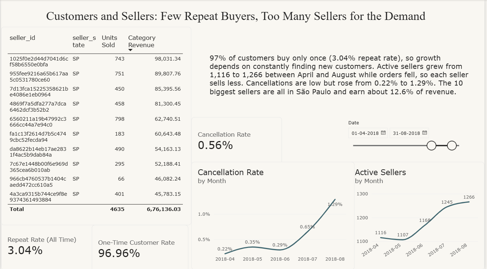
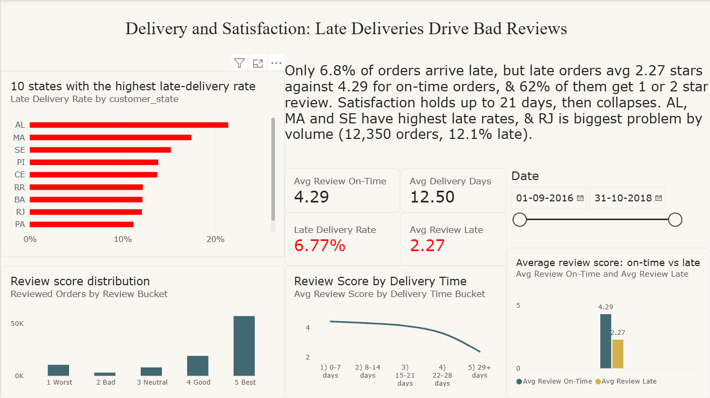
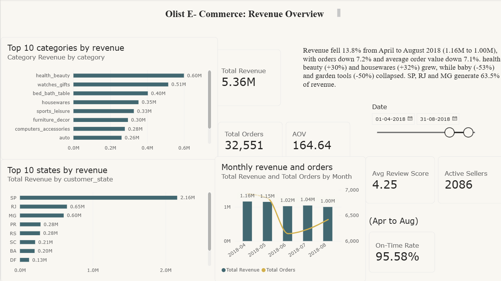

# Olist: A Brazilian Marketplace. E-Commerce Analysis
## Executive Summary

Olist's revenue fell 13.8% between April and August 2018 (1.16M to 1.00M).
The slowdown is on the **demand** side: orders fell 7.2% while active sellers
grew 13%. Late deliveries (6.8% of orders) are the main driver of bad reviews:
late orders average 2.27 stars against 4.29, and customers tolerate about
21 days before satisfaction collapses. Only 3% of customers ever buy twice.

**Priorities:** 
(1) fix late deliveries, starting with RJ and the highest-late
states; 
(2) launch a repeat-purchase programme; 
(3) investigate the decline in
baby and garden_tools.

## Data

Dataset: [Brazilian E-Commerce Public Dataset by Olist](https://www.kaggle.com/datasets/olistbr/brazilian-ecommerce) (Kaggle).
The raw and cleaned CSV files are not included in this repository.
To reproduce: download the 9 CSVs into `data/raw/`, then run the notebooks
and SQL scripts in numbered order (`01_load_data` first).

## 1. Business Brief

Olist connects small Brazilian sellers to large online marketplaces. Management says:

> "Revenue growth has slowed and customer reviews are getting worse. Tell us where we are making money, where deliveries are failing, and what to fix first."

**Tools:** MySQL (analysis), Python (cleaning and EDA), Excel (pivots and validation), Power BI (dashboard)
**Dataset:** Brazilian E-Commerce Public Dataset by Olist (Kaggle), 9 tables

---

## 2. Scope and Rules (decided up front so every number is consistent)

| Topic | Decision |
|---|---|
| Dataset range | Sep 2016 to Oct 2018. The first months (2016) and the last months (Sep/Oct 2018) have very little data. |
| "Last 5 months" | The last 5 reliable months: **Apr, May, Jun, Jul, Aug 2018**. |
| Valid orders | All orders **except** status `canceled` and `unavailable` (the dataset spells it with one "l"). |
| Delivery KPIs | Use only orders with status `delivered` that have both the delivered date and the estimated date. |
| Revenue | `price + freight_value` from `order_items` for valid orders. Freight is **included**. |
| Payment analysis | Payment mix uses `order_payments`. Totals can differ slightly from item revenue (vouchers, installments), so I reconcile the two and note the gap. |
| Customer identity | Always `customer_unique_id`, never `customer_id` (it changes with every order). |
| Delivery time | `order_delivered_customer_date` minus `order_purchase_timestamp`, in days. |
| Seller and state rankings | Only include sellers or states with at least **30 orders**, so one lucky order cannot rank first. |
| Review buckets | 5 = Best, 4 = Good, 3 = Neutral, 2 = Bad, 1 = Worst. |
Repeat rate and review distribution use the whole dataset; new vs returning customers are calculated for Apr to Aug 2018
 
Delivery rates and rankings use all delivered orders; the monthly delivery trend covers Apr to Aug 2018. Late means delivered on a later day than the estimated date.
---

## 3. Business Problems

### Problem 1: Revenue
- How do revenue, total orders and average order value trend month by month over the last 5 reliable months?
- Which product categories drive the most to the least revenue in that period, and how is each trending?

### Problem 2: Customers
- What is the repeat customer rate, the new customer rate, and the share of customers who bought only one time?
- How are reviews distributed from best to worst, and what do customers say in their comments? (Comment summarization is optional and done later with AI.)

### Problem 3: Delivery
- What is the on-time delivery rate and the late delivery rate?
- Which states and sellers rank from best to worst on delivery time?

### Problem 4: Sellers and Products
- Which states, sellers, products and product categories sell the most, down to the least?

### Problem 5: Satisfaction
- How much do late deliveries lower review scores?
- Which states, sellers and categories have the highest and lowest satisfaction?

---

## 4. Final KPI Table

| # | KPI | Definition | Tables and columns | Filters |
|---|---|---|---|---|
| 1 | Revenue | Sum of item price plus freight | `order_items` (`price`, `freight_value`) joined to `orders` | Valid orders |
| 2 | Total orders | Count of distinct orders | `orders` (`order_id`) | Valid orders |
| 3 | Average order value (AOV) | Revenue divided by total orders | KPI 1 / KPI 2 | Valid orders |
| 4 | Average delivery time (days) | Average of delivered date minus purchase date | `orders` | Delivered, both dates present |
| 5 | On-time delivery rate | Orders delivered on or before the estimated date, divided by delivered orders, times 100. **Late delivery rate = 100 minus this.** | `orders` (`order_delivered_customer_date`, `order_estimated_delivery_date`) | Delivered, both dates present |
| 6 | Order cancellation rate | Orders with status `canceled`, divided by all orders, times 100 | `orders` (`order_status`) | All orders |
| 7 | Repeat customer rate | Unique customers with 2 or more orders, divided by all unique customers, times 100 | `customers` (`customer_unique_id`) with `orders` | Valid orders |
| 8 | One-time customer rate | Unique customers with exactly 1 order, divided by all unique customers, times 100 (equals 100 minus KPI 7) | same as KPI 7 | Valid orders |
| 9 | New customer rate | Customers whose first-ever order falls in the month, divided by customers who ordered that month, times 100 | `customers`, `orders` | Valid orders |
| 10 | Average review score | Mean of `review_score` (use one review per order) | `order_reviews` | Valid orders |
| 11 | Review score: late vs on-time | Average review score for late orders compared with on-time orders | `order_reviews` with `orders` | Delivered, both dates present |
| 12 | Review distribution | Share of orders in each bucket: Best, Good, Neutral, Bad, Worst | `order_reviews` | Valid orders |
| 13 | Active sellers | Count of distinct sellers with at least one item in a valid order | `order_items` (`seller_id`) | Valid orders |
| 14 | Payment mix % | Share of orders (and of payment value) by payment type: credit card, boleto, voucher, debit card | `order_payments` (`payment_type`, `payment_value`) | Valid orders |

### Ranking tables (rankings, not single numbers)

| # | Ranking | Ranked by | Notes |
|---|---|---|---|
| R1 | Product categories | Revenue, then units sold | Use English names from the translation table |
| R2 | Products | Units sold, with revenue shown | Top 10 and bottom 10 |
| R3 | Sellers | Revenue, units sold | Top and bottom 10 |
| R4 | States | Revenue, then orders | Customer state |
| R5 | Sellers and states by delivery time | Average delivery days, fastest to slowest | Minimum 30 orders |
| R6 | States, sellers, categories by satisfaction | Average review score | Minimum 30 orders |

---

## 5. Known Data Traps (checklist while working)

- [ ] Joining `order_items` to `order_payments` duplicates rows, so aggregate first, then join.
- [ ] `customer_id` is not the person, so use `customer_unique_id`.
- [ ] A few orders have more than one review, so keep one review per order.
- [ ] Delivery dates are empty for undelivered orders.
- [ ] `geolocation` has many duplicate rows per zip code prefix.
- [ ] Some product categories have no English translation.
- [ ] Expect a repeat customer rate of only about 3%. That is a real finding, not an error.

---

## 6. Data Issues Found
*(
    1. Orders are from year 2017 because sep to dec 2016 has fewer then 330 orders and sep to oct has only 20 which would distort trends.
    2. 96,478 out of 99,441 orders are delivered, others are canceled, unavailable or on the way. Delivery KPIs use delivered orders only and revenue excludes cancelled and unavailable orders.
    3. 2,965 orders have no order delivered customer date because they were never delivered and has been excluded from delivery time and late rate calculations.
    4. There are 99,441 customer_ids out of which 96,096 are customer_unique_id as it signifies unique customers who can have multiple orders also.
    5. Review_id is different for every review which is 98,410 out of 99,224.
    6. Geolocation has latitudes and longitudes for zipcodes and duplicate entries are removed.
    7. 610 products are labeled "unkown" because they have no category name.
    8. Most customers just do star rating so I analyzed stars(1 to 5) and treat written comments as bonus.

    Revenue growth is concentrated in health_beauty and housewares, while baby, garden_tools, computers_accessories and watches_gifts declined sharply between April and August 2018.
    A few orders took up to 210 days to deliver (median 10 days, mean 12.5). I kept them as real late orders and report medians where outliers matter
 )*

## 7. Key Insights and Recommendations
*
### Insights

1. **Revenue is slowing.** Between April and August 2018, revenue fell from
   1,156,249 to 996,974 (-13.8%). Orders fell 7.2% (6,919 to 6,421) and
   average order value fell 7.1% (167.11 to 155.27), mainly in August.

2. **Growth is concentrated in two categories.** health_beauty (+30%) and
   housewares (+32%) grew between April and August, while baby (-53%),
   garden_tools (-50%), computers_accessories (-31%) and watches_gifts (-21%)
   declined sharply.

3. **Almost nobody buys twice.** Only 3.04% of customers ordered more than once,
   so 96.96% are one-time buyers. About 97% of each month's customers are new,
   so Olist depends on constantly acquiring customers.

4. **Reviews are generally good but polarised.** The average score is 4.12 and
   77.9% of reviews are 4 or 5 stars. However, 1-star reviews (10.75%) are
   more than three times as common as 2-star reviews (3.12%), which points
   to specific failures rather than mild disappointment.

5. **Late delivery is the biggest driver of bad reviews.** Late orders average
   2.27 stars versus 4.29 for on-time orders, and 62.4% of late orders get a
   1-2 star review versus 9.3% of on-time orders. Only 6.8% of orders are
   late, so the problem is concentrated and fixable.

6. **Delivery is not getting worse.** The monthly late rate stayed between
   1.2% and 6.6% with no upward trend, and average delivery time fell from
   11.4 to 7.7 days (caveat: recent months may look faster because slow
   orders may not yet be delivered in the data).
   The latest months may look faster than reality, because slow orders placed near the end of the data may not have been delivered yet, so they’re missing from delivery calculations.

7. **Delivery varies a lot by state.** Sao Paulo (SP) is fastest at 8.7 days;
   remote states such as RR, AP and AM take 26-29 days. The highest late
   rates are in AL (21.4%), MA (17.4%) and SE (15.2%). RJ is the biggest
   problem by volume: 12,350 delivered orders with a 12.1% late rate.

8. **Sales are concentrated in a few product groups.** The top-selling
   products come from watches_gifts, health_beauty, computers_accessories,
   furniture_decor and garden_tools.
9. **Sales are concentrated in São Paulo.** SP generates 40.3% of revenue, and
   SP, RJ and MG together generate 63.5%. Northern states (AM, AC, RR, AP)
   each contribute under 0.15%.

10. **The top sellers are all in São Paulo.** The 10 highest-revenue sellers
    are all in SP and together generate about 12.6% of revenue (676,136 of
    5,359,074). The single best seller earned 98,031 (1.8%).

11. **A few sellers have serious satisfaction problems.** Among sellers with
    at least 30 reviewed orders, the worst has an average review of 2.33
    (61.4% bad reviews) and the second worst 2.70 (50.0%), against 4.12
    overall.

12. **office_furniture is the biggest problem category.** It averages 3.62
    with 22.7% bad reviews across 1,262 reviewed orders. Some fashion
    categories score similarly low (3.69-3.73) but on far fewer orders.

13. **Customers judge delivery against the promised date.** AM and AP have
    the slowest deliveries but low late rates and good reviews (4.22 and 4.19);
    states with high late rates such as PI score lower. (Update after full
    state satisfaction list.)
14. **Cancellations are low overall but rose sharply in August.** The overall
    cancellation rate is 0.63% (625 of 99,441 orders), but the monthly rate
    rose from 0.22% in April to 1.29% in August (84 canceled orders vs 15).
    The absolute number is small, so it does not explain the revenue decline
    on its own, but it should be monitored.

15. **Seller supply is growing faster than demand.** Active sellers rose from
    1,116 (April) to 1,266 (August), while orders fell 7.2%. Orders per
    active seller dropped from 6.2 to 5.1 and revenue per active seller
    fell about 24% (1,036 to 788). The slowdown is on the demand side.

16. **Customers pay mostly by credit card.** Credit card accounts for 79.0%
    of payment value, boleto 16.4%, debit card 2.7% and vouchers 1.9%.
    Payment value reconciles to item revenue within 0.005%.
17. **Customers tolerate about three weeks, then satisfaction collapses.**
    Average review score is about 4.4 for deliveries within 7 days and stays
    above 4.0 up to 21 days, but falls to about 3.6 at 22-28 days and about
    2.4 beyond 29 days. Delivery time and review score have a weak-to-moderate
    negative correlation (Spearman -0.235); this shows an association, not proof
    of cause, and the relationship is non-linear.

## Dashboard

Full dashboard: `powerbi/olist_dashboard.pdf`

### Recommendations (in priority order)

### Recommendations (in priority order)

1. **Fix late deliveries first.** Late orders average 2.27 stars against 4.29.
   If late orders reviewed like on-time ones, the average score would rise
   from about 4.16 to 4.29 (+0.13). Start with RJ (12,350 orders, 12.1% late),
   then AL, MA and SE, and set a 21-day delivery limit as the alert threshold.
2. **Launch a repeat-purchase programme.** Raising the repeat rate from 3.04%
   to 5% means about 1,860 more customers placing a second order, roughly
   300,000 in extra revenue at the current average order value of 164.64
   (illustrative estimate).
3. **Investigate baby and garden_tools** (-53% and -50%) before spending on
   marketing; check seller availability, stock and pricing.
4. **Back what is growing:** recruit sellers and promote health_beauty (+30%)
   and housewares (+32%).
5. **Focus on demand, not on more sellers.** Revenue per active seller fell
   about 24%, so marketing should come before further seller recruitment.
6. **Contact the lowest-rated sellers** (average below 3.0, over 40% bad
   reviews) and review office_furniture (3.62 stars on 1,262 orders).

### Limitations
- Product names are not in the dataset, so products are analysed by ID and category.
- Review comments are mostly empty, so the analysis relies on star scores.
- This analysis shows what changed, not proof of why; causes need further investigation.
- Delivery times for the most recent months may be understated for the reason above.

(96.96% of customers bought once, positive reviews with 4-5 stars are 77.87% and negative with 1-2 stars are 13.87% with 10.75 1 star and 3.12% 2 stars and average review score is 4.12%)
*
Delivery performance did not worsen between April and August 2018. The monthly late-delivery rate ranged from 1.2% to 6.6% with no upward trend, and average delivery time fell from 11.4 to 7.7 days. Delivery is therefore unlikely to explain the revenue slowdown. Caveat: the most recent months may look faster because slow orders placed late in the period may not yet have been delivered when the data was collected.

---

## 8. Validation (how I checked my numbers)

- **SQL vs Python:** monthly revenue, orders and review distribution calculated
  in Python match the SQL results exactly.
- **Excel:** three pivot tables and a KPI summary sheet (`excel/olist_analysis.xlsx`);
  all figures reconcile exactly with the SQL results.
- **Revenue vs payments:** item revenue (5,359,074.34) and payment value
  (5,359,323.14) differ by only 0.005%.
- **Row counts:** every table has the same number of rows in the CSV and in
  MySQL; `order_summary` has 99,441 rows and `item_summary` has 112,650.

  ## Tools and Skills Used
MySQL (joins, CTEs, window functions, conditional aggregation, indexing) |
Python (pandas, matplotlib, seaborn, SQLAlchemy) | Excel (pivot tables,
SUMIFS/COUNTIFS) | Power BI (data model, DAX measures, 3-page dashboard)